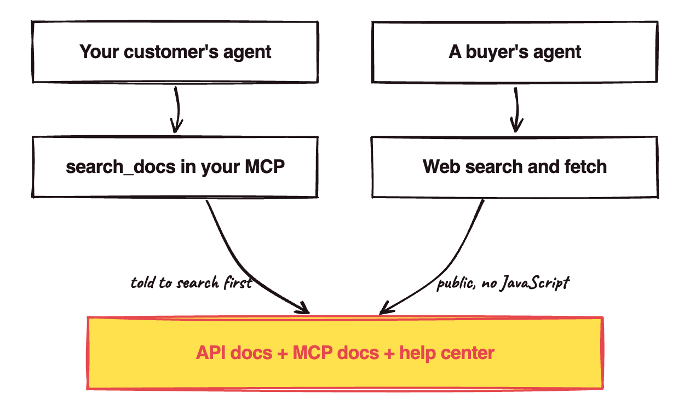

Have you ever watched Claude stop halfway through your question to go fetch a docs page? Now multiply that by every agent your customers run.

In March 2026, Claude Code alone made [199.4 million requests](https://www.mintlify.com/blog/state-of-ai) to docs hosted on Mintlify. That's more than Chrome on Windows, at 119.4 million! On GitBook, agents made [51.8% of documentation reads](https://gitbook.com/blog/ai-docs-data-april-2026) in one week this spring.

However, plenty of companies still split their docs by who used to read them:

1. API docs for developers
2. A help center for everyone else
3. MCP docs for agents

I think that split is now wrong. Agents read all three to work out how to use your product. So put all three behind **one search the agent is told to use**, in your MCP and on the public web. It's like a hotel with one front desk; guests shouldn't need to know which department handles towels.

When an agent can't find the right doc, **it acts in your customer's account on a guess**. If it calls your API the way it worked a year ago, that's a wrong order or invoice in their books. And agents guess a lot: in [Vercel's evals](https://vercel.com/blog/agents-md-outperforms-skills-in-our-agent-evals) on Next.js 16 APIs the models hadn't been trained on, an agent with no docs passed 53% of coding tasks, against 100% with docs it always saw.

## 1. Spotting docs agents can't use

You probably have at least one of these:

1. Your MCP `search_docs` tool only searches the developer docs.
2. You rely on the agent's decision on what to look up about your product.
4. Your docs need JavaScript or a login.

Stripe runs [support](https://support.stripe.com/) and [docs](https://docs.stripe.com/) as separate sites, and so do Shopify and HubSpot. Mintlify has [generated a docs MCP](https://mintlify.com/blog/generate-mcp-servers-for-your-docs) for every site it hosts since March 2025, and [GitBook does too](https://gitbook.com/docs/ai-and-search/mcp-servers-for-published-docs), but each one only searches the site it came from. Unless your MCP searches both, an agent going through it never sees the help center, which is where you explain how your product is actually used.

In Vercel's evals, the agent mostly didn't look things up on its own. Here's what they measured in January 2026:

| Docs setup | Pass rate |
| --- | --- |
| No docs | 53% |
| A docs skill the agent loads when it decides to | 53% |
| The same skill, with instructions to use it | 79% |
| A docs index in `AGENTS.md`, read every session | 100% |

The agent never even loaded the skill in 56% of cases! Vercel thinks the gap may close as models get better at tool use.

Handing it everything doesn't work either. [Chroma tested 18 models](https://www.trychroma.com/research/context-rot) and found performance "varies significantly as input length changes, even on simple tasks", and Anthropic tells builders to find "the [smallest possible set](https://www.anthropic.com/engineering/effective-context-engineering-for-ai-agents) of high-signal tokens".

Last, Claude's web fetch tool "[does not support](https://platform.claude.com/docs/en/agents-and-tools/tool-use/web-fetch-tool) websites dynamically rendered with JavaScript", causing a user's agent to potentially not be able to access the info it needs.

## 2. One search for MCP & CLI

I'm proposing that you:

1. Index the API docs, MCP docs and help center together.
2. Return only the few pages that match a query.
3. Expose the search as a tool in your MCP.
4. Tell the agent to use it, in the tool's description.
5. Put the same search behind your CLI.
6. Keep every page public and readable without JavaScript.

Stripe already does this: its MCP can "[search the Stripe knowledge base](https://docs.stripe.com/mcp), including documentation and support articles". Supabase's tool is literally called [`search_docs`](https://supabase.com/docs/guides/getting-started/mcp), and AWS, Cloudflare, Microsoft and Vercel all ship one.

Telling the agent to use it is the 79% row in Vercel's table. You can't put a docs index in your customer's `AGENTS.md`, so the tool description is the closest you get. Supabase's [description](https://github.com/supabase-community/supabase-mcp/blob/8a2650891e2fa6e5e895075663ba4f35867083d6/packages/mcp-server-supabase/src/tools/docs-tools.ts#L42) says:

> You should default to calling this even if you think you already know the answer, since the documentation is always being updated.

The CLI is for agents that call your API through one instead of your MCP (there's a whole debate over [which is better](https://mariozechner.at/posts/2025-11-02-what-if-you-dont-need-mcp/), though Sentry's [David Cramer](https://cra.mr/context-management-and-mcp) calls it the dumbest one on the planet). Stripe's CLI has [`stripe docs`](https://docs.stripe.com/cli/docs), which searches its documentation by keyword.

Keeping pages public is for buyers' agents. They don't have your MCP installed, so the open web is the only way they reach you:

## 3. Keeping it going (and selling with it)

Once it's set up:

- Re-index whenever a help article or API page changes.
- Check your MCP logs for calls to the search tool.
- If agents aren't calling it, make the description pushier.
- Keep your sites as they are for humans.

Humans are still about a third of Mintlify's docs traffic. On Mintlify in August 2026, there were [131 million human page loads against 257 million agent requests](https://www.mintlify.com/blog/the-state-of-knowledge-2026-highlights).

As for buyers, [51% of B2B software buyers](https://company.g2.com/news/g2-research-the-answer-economy) now start their research in an AI chatbot more often than in Google, up from [29% a year earlier](https://company.g2.com/news/buyer-behavior-in-2025). However, don't expect docs to get you onto the shortlist. For "what's the best software for X" prompts, [Ahrefs found](https://ahrefs.com/blog/best-lists-research/) ChatGPT cites "best X" lists more than anything else (43.8%). When it cited a vendor's own site, it was:

- a landing page 37.2% of the time
- the homepage 15.6%
- documentation only 7.6%

I think docs win the question after that, when a buyer asks how your product would actually do the job. Say you sell manufacturing software: your landing page says "production planning", and your docs show the bill of materials and the screens to plan it. So write the "how would it do X" pages as well as the API reference.

Chrome on Windows already lost to Claude Code on Mintlify's docs. Index yours for the reader that's winning.
