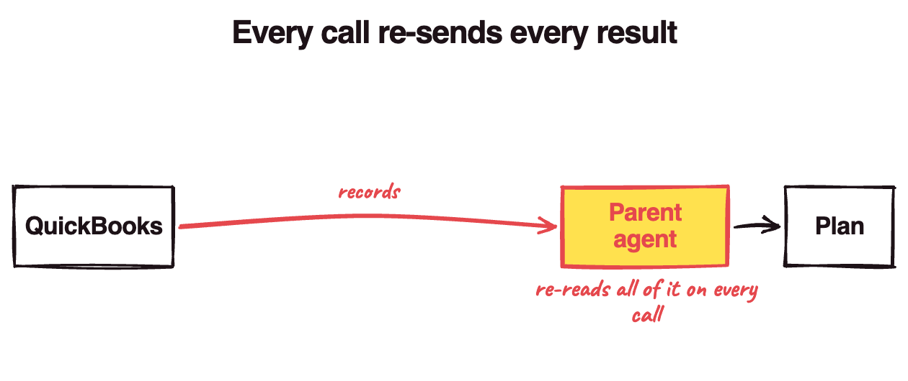
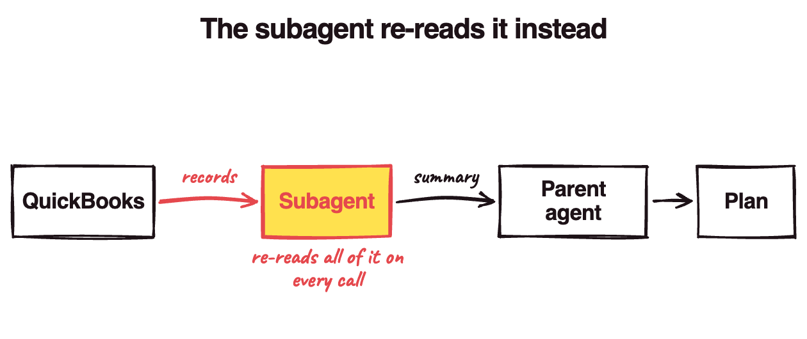

We built an agentic harness in LangGraph JS that writes to QuickBooks Online through Composio's QuickBooks tools. An orchestrator handed work to worker subagents (a QuickBooks reader on Haiku 4.5, a data transformer, a writer), and the writer's planner was a subgraph on Sonnet 4.6 that stopped on a HITL (human-in-the-loop) interrupt, so the user approved before anything got written.

Then a LangSmith trace showed one approval turn had added up to **509K prompt tokens**, up from ~7K for a simple turn. So we moved the tool work out of the parent, and the flow I expected was:

1. The messy tool work runs in subagents, each with its own context
2. The parent only gets back a short summary
3. The parent's prompts shrink, so the bill shrinks (this is where I was wrong)

It turns out, a subagent **moves** tokens, it doesn't delete them. Steps 1 and 2 worked. Step 3 didn't: most of the planner's input was conversation history we weren't caching.

To check it, we rebuilt our harness's shape (`@langchain/langgraph` 1.3.0) with a scripted model (it replays fixed answers, so nothing runs or gets billed), and counted every request it sent with Anthropic's free [`count_tokens`](https://platform.claude.com/docs/en/build-with-claude/token-counting) endpoint. The costs below are list-price arithmetic on those counts. On a "create one invoice" task:

- moving the planner's reads into a subagent cut its biggest prompt by 80%
- with the same model, that saved 4% at best, and cost 20% more once the history was cached
- caching the history cut the planner's cost by about a third
- running the subagent on Haiku cut it by more than half

**Splitting an agent into subagents to save money can leave the bill where it was, or make it bigger.**

## Why did one approval cost 509K tokens?

The model doesn't remember anything between calls. [Anthropic's docs](https://platform.claude.com/docs/en/build-with-claude/working-with-messages) put it plainly:

> The Messages API is stateless, which means that you always send the full conversational history to the API.

So every tool result in your agent's history gets sent again on every call after it, and you pay for it over and over (and over) again.

In our case, every worker's full result went into the orchestrator's messages as a `ToolMessage`: a customer list starting "Here are the first 20 of 30 customers…" (2,000+ characters), then the transformer's output, then the writer's. Every call after that re-sent all of it. The 509K was the total across that turn's model calls, each one re-sending its whole history.

## How we kept tool work out of the parent

The fix was to have each worker hand back a one-line `briefSummary` (capped at 160 characters) and put its raw data in S3. In the rebuild, that took about 1,400 tokens off every later orchestrator call in a three-task workflow.

The planner still did its own reads, though: it searched Composio for the right QuickBooks tool, then looked up the customer and the item, and every result stayed in its history. So in the rebuild, we moved those reads into a reader subagent of its own. It gets one fresh message, has its own message history, and hands back a short summary. It's the pattern Anthropic describes in [its context-engineering post](https://www.anthropic.com/engineering/effective-context-engineering-for-ai-agents):

> Each subagent might explore extensively, using tens of thousands of tokens or more, but returns only a condensed, distilled summary of its work (often 1,000-2,000 tokens).

And for the context, it worked! The planner's biggest prompt dropped from 13,096 tokens to 2,559.

## So did the subagents make it cheaper?

Not by themselves. When the planner does its own reads, every QuickBooks record sits in its history:



A subagent takes them out of the parent, but it still reads every search result and every record, and re-reads them on each of its own calls:



A subagent is like hiring an assistant to read your mail: your desk stays clear, but you're still paying someone to read every letter.

Here's what planning one invoice costs in the rebuild at list prices, counting the planner, the reader and the summaries. "As we cached it" means only the system prompt and tool definitions were cached:

| Who does the reads          | As we cached it | History cached |
| --------------------------- | --------------- | -------------- |
| The planner itself (Sonnet) | $0.113          | $0.074         |
| A subagent on Sonnet        | $0.109          | $0.089         |
| A subagent on Haiku         | $0.051          | $0.044         |

With the same model, the subagent saved 4% the way we cached. Once the history is cached, it costs 20% _more_ than letting the planner do its own reads! Caching cuts the inline planner's long history by 34%, and the subagent's short calls by only 18%.

The payloads are stand-ins sized from Composio's and Intuit's docs. With bigger ones, the subagent cost 6% more the way we cached, and 26% more once the history was cached.

Anthropic saw the same thing at a much bigger scale. In [their multi-agent research system](https://www.anthropic.com/engineering/built-multi-agent-research-system), a single agent used about 4× the tokens of a chat, and the multi-agent setup about 15×. They only call it worth it when the task is valuable enough to pay for that.

## What was the bill actually made of?

Here's the trace of our write planner creating one invoice (its numbers have the shape of one planner call):

| Tokens     | Count  | Cost   |
| ---------- | ------ | ------ |
| Not cached | 16,216 | $0.049 |
| Cache read | 8,396  | $0.003 |
| Output     | 356    | $0.005 |

Input was 91% of that call's cost, which is normal for an agent ([Manus](https://manus.im/blog/Context-Engineering-for-AI-Agents-Lessons-from-Building-Manus) reports an input-to-output ratio around 100:1). What isn't normal is the first row. Only a third of the input came from cache!

Our cache breakpoint sat on the tool definitions, so from the second call on, the planner read its tools from cache and paid full price for every message after them. A cache read costs [a tenth](https://platform.claude.com/docs/en/about-claude/pricing) of a fresh input token ($0.30 per million on Sonnet 4.6, against $3), so the history is exactly the part you want cached.

In the rebuild, caching the history cut the planner's cost by 34% and the whole run's by 29%. (The cache only lives 5 minutes, so a slow approval could break it. Here it didn't; everything worth caching finished before the user clicked approve.)

## Where subagents do save money

Look at the last row of that cost table again. The same reader on Haiku 4.5 instead of Sonnet cut planning cost by 54%. Haiku's input is a third of Sonnet's price, and our orchestrator's QuickBooks reader already ran on it, so almost all of that saving comes from the model.

## What I check now

When the context is the problem (prompts growing with every task), I reach for a subagent. When the bill is the problem:

1. Open a trace and divide cache reads by total input
2. If that's low, put a breakpoint on the history
3. Run each subagent on the cheapest model that does its job

Step 2 is one call option. `ChatAnthropic` forwards `cache_control` to Anthropic's [automatic caching](https://platform.claude.com/docs/en/build-with-claude/prompt-caching), where "the cache point moves forward automatically as conversations grow":

```ts
const model = new ChatAnthropic({ model: "claude-sonnet-4-6" }).bindTools(tools);

// in the planner node
const response = await model.invoke(state.messages, {
  cache_control: { type: "ephemeral" }, // caches the whole history, every call
});
```

Subagents cleared our parent agent's desk. The bill was one field away the whole time.
