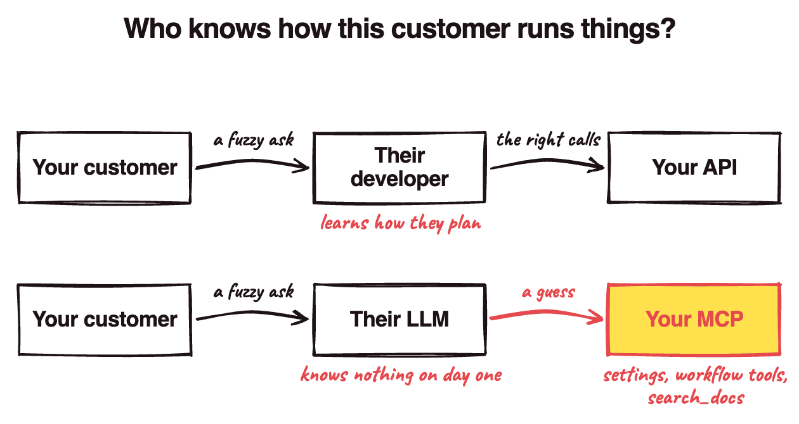

Have you ever been told an MCP is basically just a wrapper around your API? That's what a lot of engineers I talk to believe in 2026. The tooling agrees with them: Stainless, Speakeasy and FastMCP will all turn your OpenAPI spec into an MCP server with one tool per endpoint by default.

Your API gets away with being just endpoints because of who uses it. Your customer has a developer who learns how they run their business before writing a line, then turns "what should we make next month?" into the right API calls. With an MCP, your customer picks Claude or ChatGPT, and **that LLM shows up knowing nothing about how they run things**. Nobody's in the middle to translate! So it guesses, and a wrong guess on a production plan can leave your customer with stock they end up throwing out.

So the context that developer used to bring has to ship with your MCP. Ours at Distru has 70+ tools and isn't all the way there yet, so take this as what I think an MCP should look like, and what I'm building toward.

## 1. Find where the LLM has to guess

Say two of your customers ask your MCP the same thing:

> What should my production plan be for next month?

- Company A wants to use up inventory that's about to expire.
- Company B wants the most revenue.

Planning software leaves that call to you: Oracle's planner, for one, lets you [weight profit, on-time delivery and inventory turns](https://docs.oracle.com/cd/E18727-01/doc.121/e13358/T309464T309474.htm) differently on every plan. A tool that mirrors your production-planning endpoint gives the LLM no way to tell which company it's talking to.

Now picture when a user asks Claude "production plan for the next month", and it takes the wrong reading for Company A, and shipping from a fresh lot instead of the one about to expire. **The expiring lot sits on the shelf until it's worthless, and that loss lands in your customer's books.**

How often does that happen? On our MCP, Opus 5.5 gets most asks like this right, and Sonnet gets 87% right without our docs. It gets worse as the model gets weaker, and as the ask gets vaguer. In my experience the LLM can drive your software fine; what it gets wrong is what the customer meant.

The LLM has to guess wherever:

1. one question means different things to different customers
2. a workflow needs it to chain several calls
3. your terms only make sense with the help center open

## 2. Ship the context with your MCP

For Company A and Company B, give the LLM a way to find out who it's talking to. Our MCP has a `get-me` tool that returns the customer's settings. Where I want to take it: a priority the customer sets once in your app (expiring stock, or revenue) that the planning tool reads. Company A picks expiring stock, so the plan starts from the lot about to expire; Company B picks revenue. When the settings don't say, the tool should ask the user (MCP has elicitation for that, though as of this writing few clients support it).

For chained calls, build tools for the workflows your customers run most, so the business logic lives in your code instead of in the LLM's guesses. Anthropic's [guide to writing tools](https://www.anthropic.com/engineering/writing-tools-for-agents) suggests one `schedule_event` tool over separate `list_users`, `list_events` and `create_event` tools. For an ERP, that could be:

- `calculate_inventory_costs`
- `prepare_inventory_transfer`

For better LLM understanding, put the API docs, MCP docs and help center behind one `search_docs` tool, with a description telling the agent when to call it. Ours is its own tool, and I wrote [a whole post on it](/one-docs-search-for-every-agent/). Supabase's description is a good one to copy:

> You should default to calling this even if you think you already know the answer, since the documentation is always being updated.

If you want to go further, build an ontology: the same terms, entities and relationships as your docs (a lot has an expiration date, and a production plan draws from lots), as a structured model your tools query instead of pages the LLM reads. Palantir and Microsoft have each customer build their own; build yours once for your whole industry, so your customers don't have to!

## 3. Leave the long tail generic

There's a good case for going the other way. Cloudflare covers [its whole API with two tools](https://blog.cloudflare.com/code-mode-mcp/) by having the LLM write code against it. Anthropic's own [MCP builder](https://github.com/anthropics/skills/blob/9d630808e4add0a7146de4af9384155d5dee350a/skills/mcp-builder/SKILL.md#L26) now says to cover the whole API when in doubt.

I think they're right about the long tail. Nobody hand-builds a tool for every report a customer might want, so mirrored endpoints are fine there. For the common workflows your customers run every week, I'd still build the tool on purpose (just not one giant one). Code Mode still doesn't tell the LLM whether it's talking to Company A or Company B.

Each time you add a workflow tool, ask:

1. Where does the business context/nuances live?
2. Does the LLM have access to that, or know that it needs to ask?
3. Does your MCP provide the correct way for the LLM to access that context?

Company A and Company B each used to have a developer who knew how they planned. Now they have an LLM, and telling it how they plan is your MCP's job.
